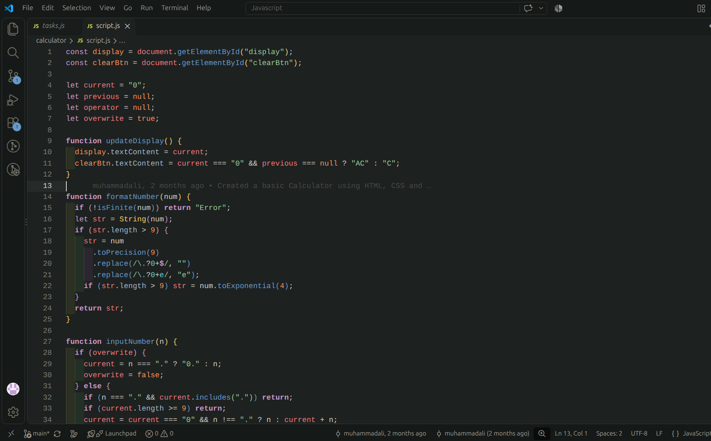
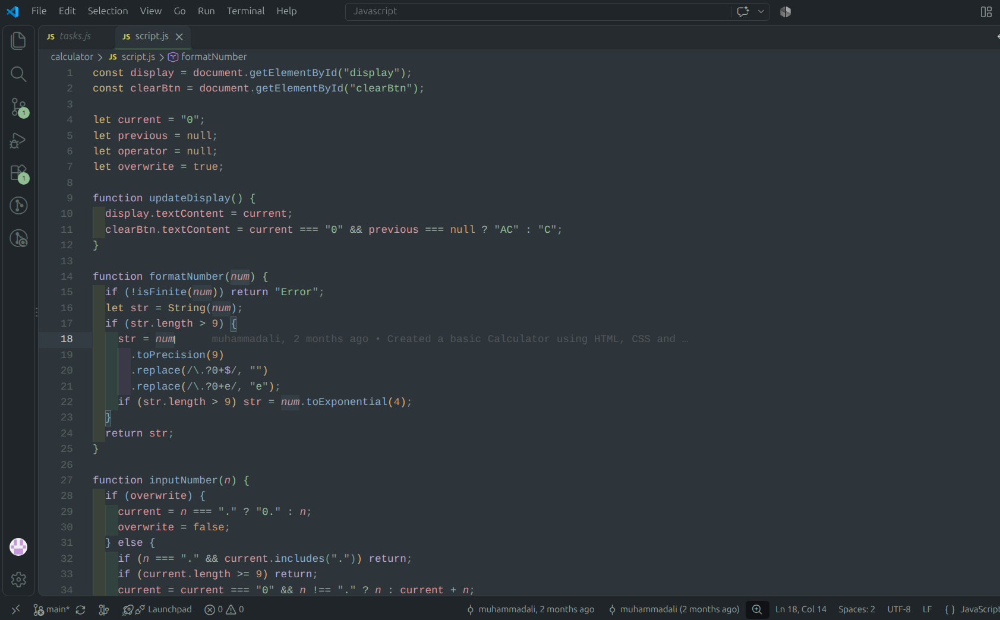
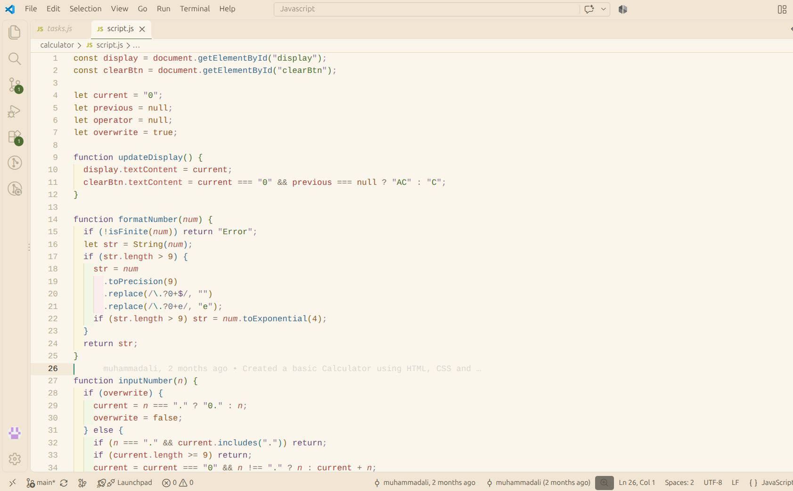
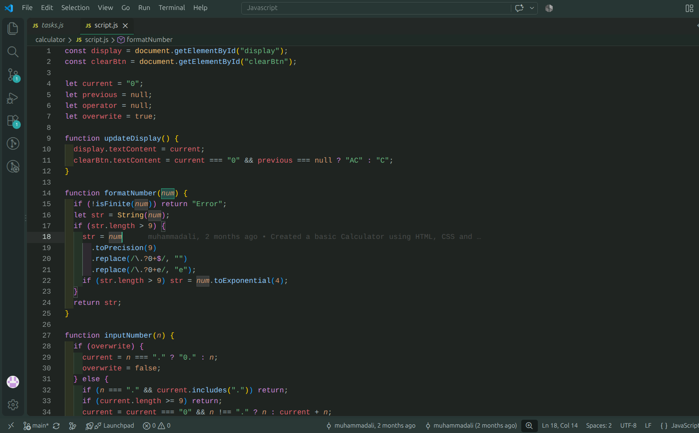
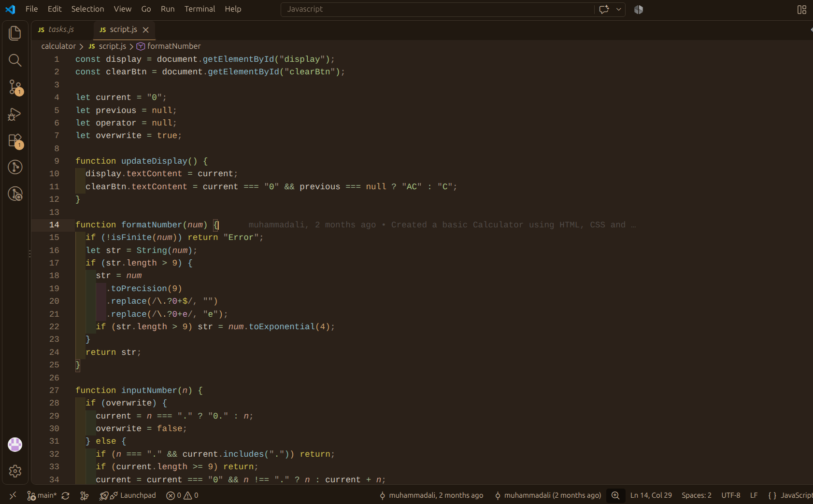

# Adones Theme

A calm, carefully balanced VS Code theme family designed for long coding sessions without relying on overly bright backgrounds or aggressive syntax colors.

Adones comes in four variants:

- 🌿 **Adones Theme** — a darker lower contrast variant, good for eyes and Late Night Work.
- ☕ **Adones Cream** — a **creamy**, lighter variant designed for daytime use.
- 🌑 **Adones Theme Darker** — A higher Contrast, better looking variant designed for Daytime/Nighttime.
- 🫘 **Adones Coffee** — A warm, espresso-toned dark variant with coffee-shop inspired syntax colors and a bit more contrast than the original Adones Theme.

> **Design philosophy:** Keep the interface comfortable, readable, and visually interesting without turning the editor into a wall of saturated colors.

---

## Preview

### Adones Minimal Dark ( Featured )

### Adones Theme

### Adones Cream

### Adones Theme Darker

### Adones Coffee

---

## ✨ Features

- 🌿 Four carefully balanced color variants
- 👀 Designed with long coding sessions in mind
- 🎨 Soft, restrained syntax highlighting
- 🖥️ Comfortable editor and UI backgrounds
- 🌙 Dark green variant for evening/night use
- ☕ Warm espresso variant for a cozier, higher-contrast feel
- 💻 Designed specifically for Visual Studio Code
- 🧩 **Tested In:** HTML, CSS, JavaScript, and should work in most other languages too.
- ⚡ Lightweight — no additional runtime dependencies

---

## 📦 Installation

### From the VS Code Marketplace

[Get it from here](https://marketplace.visualstudio.com/items?itemName=dev-mhd-ali.adones-theme)

1. Open **Extensions** in VS Code.
2. Search for **Adones Theme**.
3. Click **Install**.
4. Open the Command Palette with `Ctrl + Shift + P`.
5. Search for **Preferences: Color Theme**.
6. Select your preferred Adones variant.

---

### From a `.vsix` file

If you downloaded a `.vsix` release:

1. Open VS Code.
2. Open the Extensions panel.
3. Click the `...` menu.
4. Select **Install from VSIX...**
5. Select the downloaded `.vsix` file.
6. Select the Adones theme from the Color Theme picker.

---

## 🧪 Supported Languages

Adones has been tested with:

- HTML
- CSS
- JavaScript
- JSON

If you find a language where the syntax highlighting doesn't look right, feel free to open an issue.

---

## 💡 Suggestions

Suggestions for improving Adones are welcome.

If you have an idea for:

- Better syntax colors
- Improved contrast
- UI color adjustments
- New language support
- Accessibility improvements
- Additional theme variants

[**Suggestions for improving Adones are welcome.**](https://github.com/muhammadalidev26-prog/adones-theme/issues)

---

## 📜 License

**MIT License**

Copyright © 2026 Muhammad Ali

---

## 🙏 Credits

Created by [Muhammad Ali](https://github.com/muhammadalidev26-prog).

---

**Write code. Stay focused. Let the theme stay out of the way.**